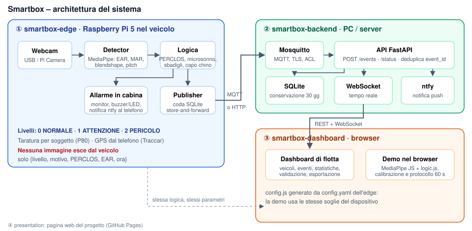

# Smartbox – backend

Monitoraggio della sonnolenza del guidatore – corso di perfezionamento 2025/26, UniSalento IDA Lab.

## Il progetto

**Smartbox** è un sistema per il monitoraggio della sonnolenza del guidatore. Una webcam nell'abitacolo,
collegata a un Raspberry Pi 5, osserva il volto del guidatore; il software di bordo misura chiusura degli
occhi (PERCLOS e microsonni), sbadigli e chinamento del capo e classifica lo stato su tre livelli:
**0 NORMALE**, **1 ATTENZIONE**, **2 PERICOLO**. L'allarme scatta in cabina (monitor, buzzer/LED,
notifica sul telefono) anche senza rete. Al server di flotta arriva solo una sintesi di ogni evento:
**nessuna immagine esce dal veicolo**.

Il progetto nasce da un prototipo di tesi (notebook Colab, versione 3) ed è stato portato a un sistema
completo *dispositivo di bordo → backend → dashboard web* (versione 4.1), verificato con prove registrate
e con l'installazione su Raspberry Pi 5.

Pagina di presentazione: **https://unisalento-idalab-corsoperfez-25-26.github.io/perfez-2526-presentation-Congedo/**

## Architettura del sistema



1. **Dispositivo di bordo (edge)**: acquisizione, misure dal volto con MediaPipe Face Landmarker,
   logica di allarme, allarme in cabina e invio degli eventi con coda *store-and-forward*.
2. **Backend**: riceve eventi e stati via MQTT (Mosquitto, TLS, ACL) o HTTP, li deduplica, li archivia in
   SQLite, li spinge alla dashboard via WebSocket e invia notifiche ntfy.
3. **Dashboard**: dashboard di flotta e demo nel browser, che esegue la stessa logica del dispositivo.
4. **Presentazione**: pagina web del progetto.

Formato degli eventi (`smartbox-evento/2`): `event_id`, veicolo, ora ISO 8601 con fuso, livello e livello
precedente, motivo, PERCLOS, EAR. Gli stati periodici (`smartbox-stato/1`) riportano fps, temperatura e
modalità del dispositivo.

## Repository dei componenti

| Componente | Repository |
|---|---|
| Dispositivo di bordo (Raspberry Pi 5) | [perfez-2526-smartbox-edge-Congedo](https://github.com/UniSalento-IDALab-corsoPerfez-25-26/perfez-2526-smartbox-edge-Congedo) |
| Backend (API, MQTT, archivio, notifiche) | [perfez-2526-smartbox-backend-Congedo](https://github.com/UniSalento-IDALab-corsoPerfez-25-26/perfez-2526-smartbox-backend-Congedo) |
| Dashboard di flotta e demo nel browser | [perfez-2526-smartbox-dashboard-Congedo](https://github.com/UniSalento-IDALab-corsoPerfez-25-26/perfez-2526-smartbox-dashboard-Congedo) |
| Pagina di presentazione (GitHub Pages) | [perfez-2526-presentation-Congedo](https://github.com/UniSalento-IDALab-corsoPerfez-25-26/perfez-2526-presentation-Congedo) |

## Questo repository: backend

Server FastAPI che fa da gateway e archivio della flotta.

### Struttura

| Percorso | Contenuto |
|---|---|
| `app.py` | Server: API REST, bridge MQTT, archivio SQLite, WebSocket, notifiche ntfy |
| `devices.example.yaml` | Modello dell'elenco dei veicoli con i loro token (il vero `devices.yaml` resta locale) |
| `mosquitto/` | Configurazione del broker Mosquitto con TLS e ACL |
| `tools/simulate_fleet.py` | Flotta simulata per popolare la dashboard senza veicoli |
| `Dockerfile` | Container del backend (predisposto, non ancora provato) |

### Avvio

```bash
pip install -r requirements.txt
cp devices.example.yaml devices.yaml          # Windows: copy
uvicorn app:app --host 0.0.0.0 --port 8000
```
- API e documentazione interattiva: http://localhost:8000/docs
- Dashboard: se il [repository dashboard](https://github.com/UniSalento-IDALab-corsoPerfez-25-26/perfez-2526-smartbox-dashboard-Congedo) è clonato nella stessa cartella
  di questo, il backend la serve su http://localhost:8000; altrimenti si indica la sua cartella con
  `SMARTBOX_FRONTEND_DIR`.

Flotta simulata (da un secondo terminale): `python tools/simulate_fleet.py --storico 7`.

### API

| Metodo | Percorso | Chi | Descrizione |
|---|---|---|---|
| POST | `/api/v1/events` | dispositivo (Bearer) | evento `smartbox-evento/2`; idempotente su `event_id` |
| POST | `/api/v1/status` | dispositivo (Bearer) | heartbeat `smartbox-stato/1` |
| GET | `/api/v1/vehicles` | dashboard | stato attuale di ogni veicolo |
| GET | `/api/v1/events` | dashboard | filtri `vehicle`, `min_level`, `since`, `only_alarms`, `limit` |
| GET | `/api/v1/stats` | dashboard | allarmi per giorno, motivo, ora; `days`, `vehicle` |
| GET | `/api/v1/export.csv` | dashboard | esportazione |
| WS | `/ws` | dashboard | push in tempo reale |

### Variabili d'ambiente

| Variabile | Default | Significato |
|---|---|---|
| `SMARTBOX_DB` | `smartbox.sqlite` | archivio degli eventi |
| `SMARTBOX_DEVICES` | `devices.yaml` | veicoli e token |
| `SMARTBOX_FRONTEND_DIR` | cartella del repository dashboard accanto a questo | file della dashboard |
| `SMARTBOX_DASHBOARD_TOKEN` | vuoto | se impostato, la dashboard chiede un token |
| `SMARTBOX_RETENTION_DAYS` | 30 | conservazione degli eventi, poi cancellazione automatica |
| `SMARTBOX_MQTT_HOST` / `_PORT` / `_USER` / `_PASS` / `_TLS` | vuoto | bridge MQTT (vuoto = disattivato) |
| `SMARTBOX_NTFY_TOPIC` / `_SERVER` / `_TOKEN` | vuoto | notifica push sulle salite di livello |
| `SMARTBOX_OFFLINE_AFTER` | 35 | secondi senza heartbeat prima di mostrare il veicolo offline |

### Affidabilità e sicurezza

- Bridge MQTT con sessione persistente e QoS 1: gli eventi arrivati mentre il backend è fermo restano nel broker.
- Consegna "almeno una volta" dal veicolo, archivio "esattamente una volta" grazie a `event_id`.
- Token Bearer per ogni dispositivo; broker con TLS e ACL per topic; dati conservati 30 giorni.

## Licenza

GPL-3.0, vedi [LICENSE](LICENSE).
